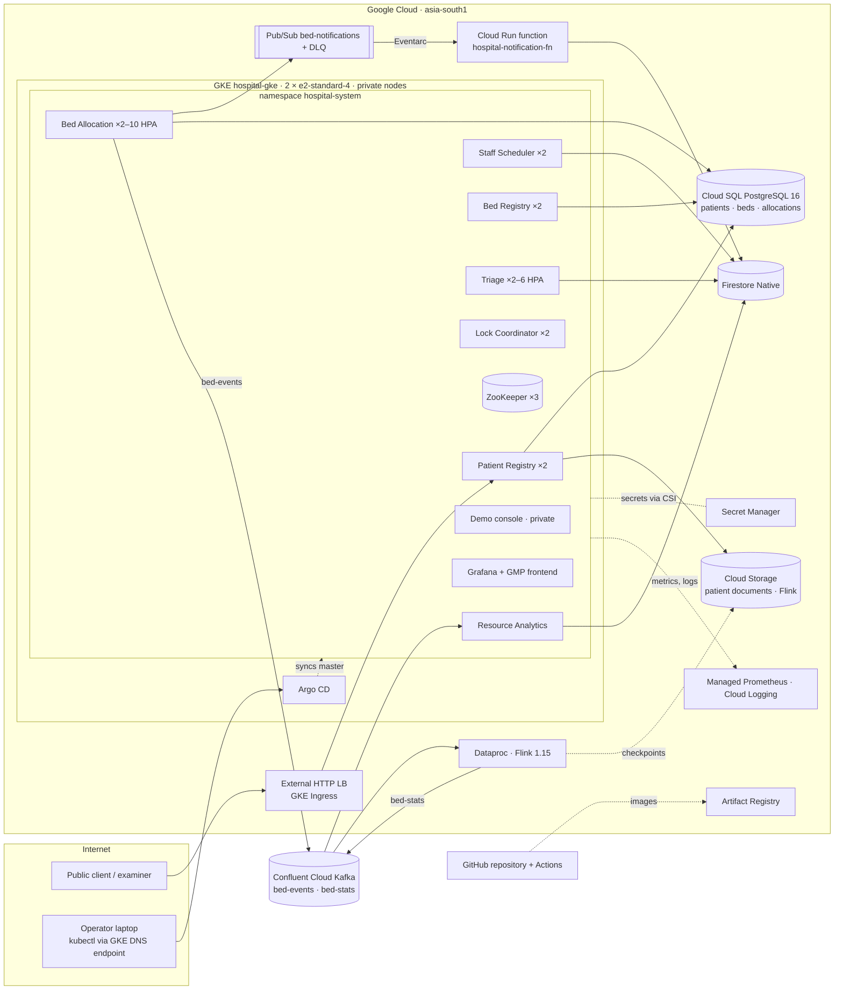
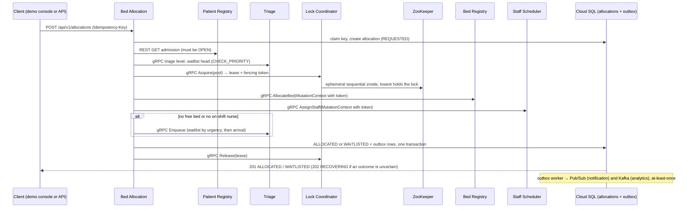

# Hospital Bed Management on Google Cloud — Project Document

BITS Pilani CS/SS G527 Cloud Computing assignment, scenario **S7: Hospital Bed Management**, concept
**distributed locking with ZooKeeper**. This document describes the whole system: what it does, how the work is
divided, how every part works, how it is deployed on Google Cloud, and how each requirement of the brief
(`docs/261_CC_Assignment_new (1).pdf`) is met. The design document deliverable is `cloud_proj_plan.docx`; §13 lists
where the built system differs from it.

Companion document: `RUNBOOK.md` (running, demo, troubleshooting). Evidence captured from the live system:
`docs/evidence/2026-11-16-gke/`.

---

## 1. System overview

A hospital admits patients into **bed pools** (for example an ICU ward). Each admission is triaged by urgency and
must receive a free bed **and** an on-shift nurse. Several replicas of the allocation service run at once, so two
requests can race for the last bed. The system guarantees:

- **No double booking.** Work on a pool is serialised by a ZooKeeper-backed lock with **fencing tokens**; a stale
  lock holder is rejected by every service that mutates state.
- **Fair waiting.** When no bed or nurse is free, the admission joins a per-pool **waitlist** ordered by urgency,
  then arrival. Releasing a bed **promotes** the most urgent waiting admission automatically.
- **Safe retries.** Every write takes an `Idempotency-Key`; a retry returns the original result. Uncertain
  downstream outcomes are recorded and **recovered**, never guessed.
- **Reliable events.** State changes and their events commit in one database transaction (**transactional
  outbox**), then go to Pub/Sub (staff notifications through a serverless function) and Kafka (real-time analytics
  with Flink).

Everything runs on Google Cloud (project `hospital-management-514618`, region `asia-south1`), provisioned with
Terraform and deployed with Argo CD from this repository.

## 2. Team and division of work

The brief asks each member to own two of the requirements (a)–(h) and two services. Source of truth:
`task_divison.txt`.

| Member | ID | Requirements owned | Services owned | Platform work |
|---|---|---|---|---|
| A — Ruchir Kumar | 2026H1030083P | (a) Infrastructure as Code, (d) GitOps | Patient Registry, Staff Scheduler | Terraform for VPC, GKE, Cloud SQL, IAM, Secret Manager; Argo CD; state |
| B — Pratham Soneja | 2026H1030055P | (c) GKE, HPA and load test, (h) observability | Bed Allocation, Triage | Kubernetes manifests, HPAs, k6, Prometheus/Grafana, CI/CD and release gate, demo console |
| C — Nisarg Vagh | 2026H1030066P | (f) the ZooKeeper concept, (b) serverless function and communication | Lock Coordinator (+ ZooKeeper), Notification | ZooKeeper StatefulSet, Pub/Sub, Eventarc, Cloud Run function, dead-letter policy |
| D — Jay Patel | 2026H1030072P | (e) Flink stream processing, (g) storage | Bed Registry, Resource Analytics (+ Flink job) | Confluent Kafka, Dataproc Flink, GCS checkpoints, Firestore analytics |

## 3. Requirement coverage

| Brief | Implementation | Evidence |
|---|---|---|
| ≥ 8 microservices | Patient Registry, Staff Scheduler, Bed Allocation, Triage, Lock Coordinator, Notification, Bed Registry, Resource Analytics (+ the Flink job) | `01`, `02` |
| One web service on a public URL | Patient Registry REST API behind a GKE external HTTP load balancer: `http://35.244.157.132/docs` | `03` |
| (a) All infrastructure by IaC | Terraform root stack (`infra/terraform`, 10 modules) + `bootstrap` (state bucket) + `bootstrap_k8s` (Argo CD Helm release); state in GCS | `10`, `terraform state list` |
| (b) Serverless function, async and event-driven | Notification as a Cloud Run function (2nd gen) triggered by Eventarc on Pub/Sub `bed-notifications`, DLQ after 10 attempts | `08` |
| (b) REST + gRPC + message queues | REST (clients, public API, Allocation → Patient Registry); gRPC (Allocation → Triage, Lock Coordinator, Bed Registry, Staff Scheduler); Pub/Sub and Kafka | `04`–`09` |
| (c) Managed Kubernetes, 2 HPAs, load test | GKE Standard; HPAs on Bed Allocation (2–10) and Triage (2–6) at 60 % CPU; in-cluster k6 Job | `02`, `11` |
| (d) GitOps, no `kubectl apply` of services | Argo CD app of apps tracking `master`; CI builds, digest-pins and commits images | `01` |
| (e) Flink on a managed cluster, Kafka in, windowed aggregation, results topic | Flink SQL on Dataproc: `bed-events` → 1-minute tumbling event-time windows per pool → `bed-stats`; Confluent Cloud Kafka | `09` |
| (f) Scenario concept | ZooKeeper lock per pool with leases and fencing tokens; enforced by Bed Registry, Staff Scheduler and Triage | `04`, `07` |
| (g) Three storage products | Cloud SQL PostgreSQL 16, Firestore Native, Cloud Storage | `03`, `04`, `10` |
| (h) Prometheus + Grafana, centralized logging | Managed Service for Prometheus + in-cluster Grafana dashboard; Cloud Logging for all pods, the function and Dataproc | Grafana, Logs Explorer |
| Deliverables | `cloud_proj_plan.docx`, this document, code, Terraform, manifests, `task_divison.txt` | repository |

(Evidence file numbers refer to `docs/evidence/2026-11-16-gke/`.)

## 4. Architecture

### 4.1 Cloud deployment

### 4.2 One allocation, end to end

### 4.3 Event pipelines

- **Notifications:** outbox → Pub/Sub `bed-notifications` (attributes `event_id`, `pool_id`, `stream_sequence`) →
  Eventarc → Cloud Run function → schema validation → Firestore dedup by `event_id` and per-pool gap detection →
  structured `staff_notification` log. Permanent errors are acknowledged; temporary ones are retried with 10–600 s
  backoff; after 10 attempts the message goes to `bed-notifications-dlq`.
- **Analytics:** outbox → Kafka `bed-events` (key `pool_id`, so per-pool order) → Flink SQL on Dataproc →
  1-minute tumbling windows on event time (5 s watermark) → Kafka `bed-stats` → Resource Analytics consumer →
  Firestore `pool_stats` → `GET /api/v1/analytics/summary`.

## 5. Services

| Service | Owner | Interfaces (container ports) | Calls | Storage | Replicas |
|---|---|---|---|---|---|
| Patient Registry | Ruchir | REST 8000 — patients, admissions, documents; **public** `/api/v1`, `/docs`, `/healthz` | — | Cloud SQL `patients`, GCS `hospital-patient-docs-514618` | 2 |
| Staff Scheduler | Ruchir | REST 8000 (roster, shifts); gRPC 50051 (capacity, assign, release) | — | Firestore `staff`, `staff_assignments`, `staff_pool_fence` | 2 |
| Bed Allocation | Pratham | REST 8000 — allocations, release, list | REST Patient Registry; gRPC Triage, Lock, Bed Registry, Staff; Pub/Sub; Kafka | Cloud SQL `allocations` (state, idempotency, outbox) | 2–10 (HPA) |
| Triage | Pratham | REST 8000 (triage PUT, waitlist GET); gRPC 50051 (enqueue, peek, remove) | gRPC Lock (validate) | Firestore `triage_records`, `waitlist_entries`, `pool_fence_state` | 2–6 (HPA) |
| Lock Coordinator | Nisarg | gRPC 50051 (Acquire, Renew, Release, Validate); REST 8000 (inspector, metrics) | ZooKeeper 2181 | ZooKeeper ensemble (3 pods, PVCs) | 2 |
| Notification | Nisarg | Cloud Run function (CloudEvent from Eventarc) | — | Firestore `notifications`, `notification_streams` | 0–3 |
| Bed Registry | Jay | REST 8000 (beds, fencing token); gRPC 50053 (AllocateBed, ReleaseBed) | — | Cloud SQL `beds` | 2 |
| Resource Analytics | Jay | REST 8008 (summary, pool latest/history) | Kafka `bed-stats` consumer | Firestore `pool_stats` | 1 |
| Flink job `hospital-bed-stats-1m` | Jay | Flink SQL on Dataproc | Kafka `bed-events` → `bed-stats` | GCS checkpoints | session on YARN |
| Demo console (not one of the 8) | Pratham | Web page + allowlisted proxy to the real APIs | REST to six services | — | 1, private |

## 6. Interconnection mechanisms and contracts

Contracts live in `contracts/`: Protobuf (`proto/common.proto`, `lock.proto`, `bed.proto`, `staff.proto`,
`triage.proto`), OpenAPI (`openapi/*.yaml`) and JSON Schemas for events (`events/*.schema.json`). CI checks that
the generated gRPC stubs match the protos.

- **REST conventions.** `X-Request-ID` is propagated through every call and log line. Every `POST`/`PUT` needs an
  `Idempotency-Key`; the same key with the same body replays the original response, with a different body returns
  409 `IDEMPOTENCY_MISMATCH`. Errors always use one envelope:
  `{"error": {"code", "message", "request_id", "retryable"}}` — 400 `INVALID_ARGUMENT`, 404 `NOT_FOUND`,
  409 `STATE_CONFLICT` / `ACTIVE_ALLOCATION_EXISTS`, 503 `SERVICE_UNAVAILABLE`, 504 `DEADLINE_EXCEEDED`.
  Waitlisting is a successful 201, not an error. An accepted but unresolved allocation returns 202 `RECOVERING`
  with a `Location` header.
- **gRPC `MutationContext`.** Every mutating RPC (`Triage.Enqueue/RemoveEntry`, `Bed.AllocateBed`,
  `Staff.AssignStaff`) carries `operation_id, request_id, pool_id, lock_id, owner_id, fencing_token`. Receivers keep
  the highest token per pool and reject lower ones (`FAILED_PRECONDITION` / 409); `operation_id` makes retries
  idempotent.
- **Lock Coordinator semantics.** `lock_id` is `<pool>/lock-<10 digits>`; the fencing token is the znode's `czxid`
  (increasing, not by 1). `Acquire` waits up to `wait_timeout_ms` (5 s) and grants a lease (`lease_ms`, 10 s) that
  starts at grant time; retries with the same `owner_id` + `acquire_id` share one place in the queue. `Release` is
  retry-safe through a 10-minute tombstone.
- **Events.** Notification events: `BED_ALLOCATED`, `ALLOCATION_WAITLISTED`, `BED_RELEASED` (+ `ALLOCATION_CONFLICT`
  in the schema), with `event_id` (dedup) and per-pool `stream_sequence` (gap detection); `ward` is `null` when no
  bed is assigned. Kafka `bed-events` carry the same facts plus lock and wait metrics; `bed-stats` carry per-pool
  window aggregates.

## 7. How it works

### 7.1 Allocation workflow
1. **Claim.** The idempotency claim (method + operation + target + key, with a canonical body fingerprint) and the
   allocation row are written first. A matching retry returns the same allocation.
2. **Check.** The admission must exist and be `OPEN` (Patient Registry). Triage supplies the urgency and whether a
   more urgent admission is already waiting (`CHECK_PRIORITY`).
3. **Lock.** `Acquire(pool)` returns a lease and fencing token; requests for the same pool queue in ZooKeeper, other
   pools are independent.
4. **Mutate.** Bed Registry reserves a bed and Staff Scheduler assigns an on-shift nurse, each with the
   `MutationContext`. Each step's intent is persisted before the call and its outcome after; no database
   transaction is held across a network call.
5. **Settle.** `ALLOCATED`, or `WAITLISTED` (only when a bed or nurse shortage is confirmed; a reserved bed is first
   released safely). State and outbox rows commit together; the lock is released.
6. **Recover.** If an outcome is uncertain, the allocation stays `RECOVERING` with a `pending_action` and stable
   operation IDs; a recovery worker on any replica reconciles it later. Nothing is double-applied because every
   downstream call is idempotent by `operation_id` and fenced by token.

### 7.2 Release and promotion
Releasing confirms the bed and nurse release first, then marks the allocation `RELEASED`. Under the same pool lock
the head of the waitlist (lowest `triage_level`, then earliest `queued_at`, then `entry_id`) is promoted onto the
freed bed. If promotion fails, the release stands and the waitlist entry is kept for a retry.

### 7.3 Locking and fencing (the S7 concept)
Each acquire creates an ephemeral sequential znode under `/locks/<pool>`; the lowest sequence number holds the
lock and each waiter watches only its predecessor (no herd effect). Ephemeral nodes vanish if the coordinator's
session dies; leases cover a frozen caller, and a reaper deletes expired locks with a version-checked delete so a
concurrent renew always wins. All state is in ZooKeeper, so any coordinator replica serves any call. The fencing
token protects against the stale-holder problem: a client that paused past its lease cannot write, because Bed
Registry, Staff Scheduler and Triage reject its lower token. ZooKeeper runs as a 3-node StatefulSet (quorum 2,
PodDisruptionBudget `maxUnavailable: 1`, one PVC per node).

### 7.4 Transactional outbox
Every state change writes outbox rows (one per destination, `pubsub` and `kafka`) in the same transaction. A worker
publishes them with backoff, in per-pool order, and marks each destination delivered; a broker outage only delays
delivery. `OUTBOX_DESTINATIONS` selects the destinations (`pubsub,kafka` in production).

### 7.5 Stream analytics
The Flink SQL job (`services/resource_analytics/flink_job.sql`) reads `bed-events` with SASL_SSL, converts the
ISO-8601 `event_time` to an event-time column with a 5-second watermark, and aggregates 1-minute tumbling windows
per pool: `requests`, `allocated`, `waitlisted`, `released`, `conflicts` (contended locks), `contention_rate`,
average lock wait and allocation wait. Counts use `COUNT(DISTINCT …)` because delivery is at-least-once. Results
go to `bed-stats` keyed by `pool_id`; checkpoints (exactly-once, 60 s) go to `gs://hospital-flink-514618/checkpoints`.
`submit_flink_job.sh` reads the Flink Kafka credentials from Secret Manager into memory and submits over IAP SSH,
so no credential is written to GCS or disk.

## 8. Infrastructure as Code (`infra/terraform`)

| Stack / module | Creates |
|---|---|
| `bootstrap` | GCS bucket for Terraform state (versioned, uniform access) |
| `network` | VPC `hospital-vpc`, subnet with Pod/Service ranges, Cloud Router + NAT, private services access, firewall rules (internal, GKE health checks, IAP SSH to Dataproc) |
| `gke` | Zonal GKE Standard cluster, private nodes, DNS endpoint, Workload Identity, Managed Prometheus packages, node pool (e2-standard-4, max 2) |
| `cloudsql` | PostgreSQL 16 instance (private IP), databases `patients`, `beds`, `allocations`, users with write-only passwords |
| `firestore` | Firestore Native database and composite indexes (`waitlist_entries`, `pool_stats`) |
| `storage` | Buckets for patient documents and Flink artifacts/checkpoints |
| `registry` | Artifact Registry `hospital-repo` |
| `iam` | One service account per workload with Workload Identity bindings and least-privilege roles; GitHub Actions Workload Identity Federation (trusted only for `master`) |
| `notifications` | Pub/Sub topic + DLQ, the Cloud Run function (source zip in GCS), Eventarc trigger, imported subscription with DLQ policy, Secret Manager containers |
| `dataproc` | Single-node Dataproc cluster with the Flink component (fits the 12-vCPU quota next to GKE) |
| `confluent` | Confluent environment, cluster, topics `bed-events`/`bed-stats`, per-component service accounts, API keys and role bindings |
| `bootstrap_k8s` | Argo CD Helm release |

Secrets: database URLs and Kafka credentials are Secret Manager versions mounted into pods with the Secret Store
CSI driver; passwords are write-only Terraform attributes. The state bucket is the single source of truth
(`terraform/state`).

## 9. GitOps and CI/CD

- **Argo CD app of apps.** `gitops/bootstrap/root-application.yaml` (registered once) watches `gitops/apps/` on
  `master`; each child Application renders a Kustomize path under `k8s/`, `monitoring/` or `k6/` into
  `hospital-system`. Patient Registry, Staff Scheduler and Lock Coordinator auto-sync; the others are synced
  deliberately (migrations, load test). Schema migrations run as Argo CD hooks/Jobs with dedicated migrator
  identities.
- **CI (`.github/workflows/ci.yml`) on every pull request:** proto/stub check, Terraform fmt + offline validate,
  Compose validation, render + kubeconform + **release gate** for every Argo CD path (no placeholders, every image
  digest-pinned), Prometheus rule tests, the full test suite against a local sandbox (PostgreSQL, Firestore and
  Pub/Sub emulators, Kafka, ZooKeeper), a k6 load procedure with invariant audit, and image smoke tests.
- **On merge to `master`:** the publish job authenticates with Workload Identity Federation (no keys), builds all 8
  GitOps images, pins their digests into the overlays and commits `chore(gitops): promote images …`. Argo CD then
  deploys exactly what is in Git.

## 10. Observability

- **Metrics.** Every service exposes Prometheus metrics on `/metrics` (RED metrics, allocation outcomes, lock waits,
  outbox backlog). Google Managed Service for Prometheus scrapes them through `PodMonitoring` (60 s); GKE adds HPA,
  Deployment, Pod and cAdvisor metrics.
- **Grafana** (`monitoring/`, in-cluster, private) reads through the GMP query frontend. Dashboard "Hospital
  Management – Allocation & Triage Service Overview": request rate (RPS), 5xx error rate, p50/p95 latency,
  allocation outcomes, lock wait duration, lock acquire outcomes and lease expiry, outbox backlog, HPA current vs
  desired replicas, pod CPU/memory, Kubernetes available replicas and restarts. Alert rules: `monitoring/rules/`.
- **Logs.** All services write structured JSON (with `request_id`, `pool_id`, `allocation_id`); GKE workload
  logging, the Cloud Run function and Dataproc send them to Cloud Logging.

## 11. Security

Private GKE nodes and a private-IP Cloud SQL; control plane through the IAM-gated DNS endpoint; Workload Identity
everywhere (no service-account keys); secrets only in Secret Manager; least-privilege database roles (runtime roles
have DML only, migrations use separate users); NetworkPolicies restrict who may call Bed Allocation, Triage and the
Lock Coordinator/ZooKeeper; service containers run as non-root (most with read-only root filesystems); the demo
console is never exposed publicly; only Patient
Registry's API and docs are public, with synthetic data. Leaked credentials found in history were rotated and the
files removed.

## 12. Design decisions

| Decision | Rationale |
|---|---|
| Lock per pool, not per bed | Allocation decisions (bed + nurse + waitlist order) are per pool; different pools never block each other |
| ZooKeeper with fencing tokens instead of a database lock | Ordered ephemeral sequential nodes give fair queuing and automatic loss on failure; fencing makes correctness independent of lease timing |
| Hand-written lock recipe on raw znodes | Needed idempotent acquire, version-checked reaping and retry-safe release that library recipes do not provide |
| Transactional outbox | No lost or phantom events; brokers never hold up a lock or a transaction |
| Recovery state instead of failing | An uncertain remote outcome is reconciled with stable operation IDs instead of guessed, so retries never double-book |
| Cloud SQL for allocations, beds, patients | Relational integrity, partial unique index for one active allocation per admission, ACID outbox |
| Firestore for triage, staff, notifications, analytics | High-write, document-shaped data with transactions; scales without capacity planning |
| GCS for documents and checkpoints | Durable, cheap object storage for binary data |
| Pub/Sub for notifications, Kafka for analytics | Push-based serverless trigger with DLQ for notifications; ordered, replayable log for stream processing |
| Notification as a Cloud Run function | The brief's serverless function: deployed from source, scales to zero, event-driven via Eventarc |
| Confluent Cloud for Kafka | Managed Kafka allowed by the brief; keeps the GKE nodes for the services |
| Digest-pinned images and a release gate | What runs is exactly what was tested and is in Git |

## 13. Differences from the design document

1. Kafka is a Confluent Cloud **Standard** cluster on GCP asia-south1; it was enabled in a second phase (PR #22).
   Events from before that switch arrive late for their original Flink windows.
2. Dataproc is a **single-node** cluster (2 vCPU) to fit the project's 12-vCPU quota with two GKE nodes.
3. Bed Registry uses a separate migration identity and a DML-only runtime role.
4. Prometheus is **Google Managed Service for Prometheus**; Grafana runs in the cluster.
5. The control plane is reached through the GKE **DNS endpoint**.
6. The public web service is **Patient Registry** over plain HTTP (`/api/v1`, `/docs`, `/healthz`), synthetic
   data only; `/metrics` and `/readyz` are not routed.
7. A private **demo console** drives the real APIs; it is not one of the eight services.
8. Notification is a **Cloud Run function (2nd gen)** behind Eventarc with a DLQ.
9. Firestore **composite indexes** are managed in Terraform (the waitlist and analytics queries need them).
10. Every POST requires an **`Idempotency-Key`**, including on the public API.

## 14. Repository layout

| Path | Contents |
|---|---|
| `services/` | The eight services, the demo console and the Flink job (`resource_analytics/flink_job.sql`) |
| `shared/` | Logging, metrics middleware, error envelope, generated gRPC stubs |
| `contracts/` | Protobuf, OpenAPI and event JSON Schemas |
| `migrations/`, `alembic.ini` | Bed Allocation database migrations (Patient Registry has its own under its service) |
| `infra/terraform/` | Root stack, modules, `bootstrap`, `bootstrap_k8s` |
| `gitops/` | Argo CD root and child Applications |
| `k8s/` | Kustomize bases and GKE overlays for every service; migration Jobs |
| `monitoring/` | Grafana, datasources, PodMonitorings, dashboard, alert rules |
| `k6/` | Load test script and the in-cluster Job |
| `tests/` | Unit, integration, acceptance tests and the local sandbox (`tests/sandbox/cli.py`) |
| `scripts/` | Release gate, digest pinning, proto compilation, image smoke tests, demo helpers |
| `.github/workflows/ci.yml` | CI and image promotion |
| `compose.yaml`, `.env.*.example` | Local development stack |
| `docs/` | The assignment brief and the cloud evidence |
| `README.md`, `PROJECT.md`, `RUNBOOK.md` | Overview, this document, and how to run and demonstrate the system |
| `cloud_proj_plan.docx`, `task_divison.txt` | Design document and task division (deliverables) |
