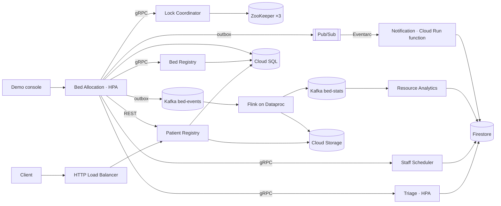

# Hospital Bed Management on Google Cloud

A cloud-native, microservice system that admits patients, triages them by urgency and allocates hospital beds and
on-shift nurses **without ever double-booking a bed**, even when many replicas handle requests for the same ward at
once. Built for BITS Pilani **CS/SS G527 Cloud Computing** (scenario **S7 — Hospital Bed Management**, concept:
**distributed locking with ZooKeeper**) and deployed end to end on Google Cloud.

**Public web service:** <http://35.244.157.132/docs> — Patient Registry REST API (synthetic data only; every POST
needs an `Idempotency-Key` header).

## Highlights

- **8 microservices** in Python (FastAPI + gRPC): 7 on GKE, 1 serverless Cloud Run function.
- **ZooKeeper lock per pool with fencing tokens** — concurrent requests queue fairly; a stale lock holder is rejected
  by every service that mutates state.
- **Urgency-ordered waitlist** with automatic promotion when a bed is released.
- **Idempotent, recoverable workflow** — retries never double-apply; uncertain outcomes are reconciled.
- **Transactional outbox** to **Pub/Sub** (staff notifications via Eventarc → Cloud Run function, with DLQ) and
  **Kafka** (Confluent Cloud → **Flink on Dataproc** → 1-minute windowed analytics → `bed-stats` → Firestore).
- **Everything as code:** Terraform for all infrastructure, Argo CD (GitOps) for every deployment, CI that tests,
  builds, digest-pins and promotes images.
- **Autoscaling and observability:** HPAs on Allocation and Triage verified with an in-cluster k6 load test; Managed
  Prometheus, Grafana and Cloud Logging.

## Architecture



Full diagrams, workflows and design rationale: [`docs/PROJECT.md`](docs/PROJECT.md).

## Services

| Service | Owner | Role | Storage |
|---|---|---|---|
| Patient Registry | Ruchir Kumar | Patients, admissions, documents; the public web service | Cloud SQL, Cloud Storage |
| Staff Scheduler | Ruchir Kumar | Nurse roster and shifts; fenced staff assignment (gRPC) | Firestore |
| Bed Allocation | Pratham Soneja | Allocation orchestrator: lock, beds, staff, waitlist, recovery, outbox | Cloud SQL |
| Triage | Pratham Soneja | Urgency records and the per-pool priority waitlist | Firestore |
| Lock Coordinator | Nisarg Vagh | ZooKeeper locks, leases and fencing tokens (gRPC) | ZooKeeper |
| Notification | Nisarg Vagh | Serverless staff notifications from Pub/Sub, dedup, DLQ | Firestore |
| Bed Registry | Jay Patel | Bed inventory with fencing-token enforcement | Cloud SQL |
| Resource Analytics | Jay Patel | Consumes Flink window results, serves analytics | Firestore (+ Flink checkpoints in GCS) |

## Requirements of the brief

| Requirement | How it is met |
|---|---|
| ≥ 8 microservices, one on a public URL | The eight services above; Patient Registry behind a GKE external load balancer |
| (a) Infrastructure as Code | Terraform (`infra/terraform`): network, GKE, Cloud SQL, Firestore, storage, IAM, Pub/Sub, Eventarc, function, Dataproc, Confluent, Argo CD |
| (b) Serverless function + REST, gRPC, message queues | Notification on Cloud Run functions via Eventarc; REST, gRPC, Pub/Sub and Kafka all used |
| (c) Managed Kubernetes, HPA, load test | GKE; HPAs on Bed Allocation (2–10) and Triage (2–6); k6 Job |
| (d) GitOps | Argo CD app of apps tracking `master`; no `kubectl apply` of services |
| (e) Flink stream processing | Flink SQL on Dataproc: Kafka `bed-events` → 1-minute tumbling windows → Kafka `bed-stats` |
| (f) Scenario concept | ZooKeeper distributed locking with fencing tokens |
| (g) Three storage products | Cloud SQL, Firestore, Cloud Storage |
| (h) Observability | Managed Prometheus + Grafana dashboard; Cloud Logging for all services and the Flink job |

Evidence from the live system: [`docs/evidence/2026-11-16-gke/`](docs/evidence/2026-11-16-gke/README.md).

## Documentation

| Document | Contents |
|---|---|
| [`docs/PROJECT.md`](docs/PROJECT.md) | Everything about the system: team and division of work, requirement coverage, architecture, services, contracts, how it works, IaC, GitOps, observability, security, design decisions, differences from the design document |
| [`docs/RUN-DEMO-VIVA.md`](docs/RUN-DEMO-VIVA.md) | How to run it (cloud and local), the demo script covering every requirement, viva preparation per member, troubleshooting |
| [`cloud_proj_plan.docx`](cloud_proj_plan.docx) | Design document (deliverable) |
| [`task_divison.txt`](task_divison.txt) | Team members, IDs and task division (deliverable) |
| [`docs/261_CC_Assignment_new (1).pdf`](<docs/261_CC_Assignment_new (1).pdf>) | The assignment brief |

## Quick start

**Cloud (team members):**
```bash
gcloud container clusters get-credentials hospital-gke --location=asia-south1-a --project=hospital-management-514618 --dns-endpoint
kubectl -n argocd get applications
kubectl -n hospital-system port-forward svc/demo-ui 8080:80
```
Then open <http://localhost:8080>. Provisioning, deployment, Flink and the load test: `docs/RUN-DEMO-VIVA.md` Part A.

**Local tests:**
```bash
pip install -r requirements.txt
python -m pytest -q
python -m tests.sandbox.cli infra-up && python -m tests.sandbox.cli verify
```

## Repository layout

```text
services/          eight services, the demo console and the Flink SQL job
shared/            logging, metrics, error envelope, generated gRPC stubs
contracts/         Protobuf, OpenAPI and event JSON Schemas
infra/terraform/   root stack, modules, bootstrap (state) and bootstrap_k8s (Argo CD)
gitops/            Argo CD root and child Applications
k8s/               Kustomize bases, GKE overlays and migration Jobs
monitoring/        Grafana, Managed Prometheus scraping, dashboard and alert rules
k6/                load test script and in-cluster Job
tests/             unit, integration and acceptance tests; local sandbox
scripts/           release gate, digest pinning, smoke tests, demo helpers
docs/              project document, run/demo/viva guide, brief, evidence
```

## Team

| Member | ID | Requirements | Services |
|---|---|---|---|
| Ruchir Kumar | 2026H1030083P | (a) IaC, (d) GitOps | Patient Registry, Staff Scheduler |
| Pratham Soneja | 2026H1030055P | (c) GKE/HPA/load test, (h) observability | Bed Allocation, Triage |
| Nisarg Vagh | 2026H1030066P | (f) ZooKeeper concept, (b) serverless and communication | Lock Coordinator, Notification |
| Jay Patel | 2026H1030072P | (e) Flink/Kafka, (g) storage | Bed Registry, Resource Analytics |
