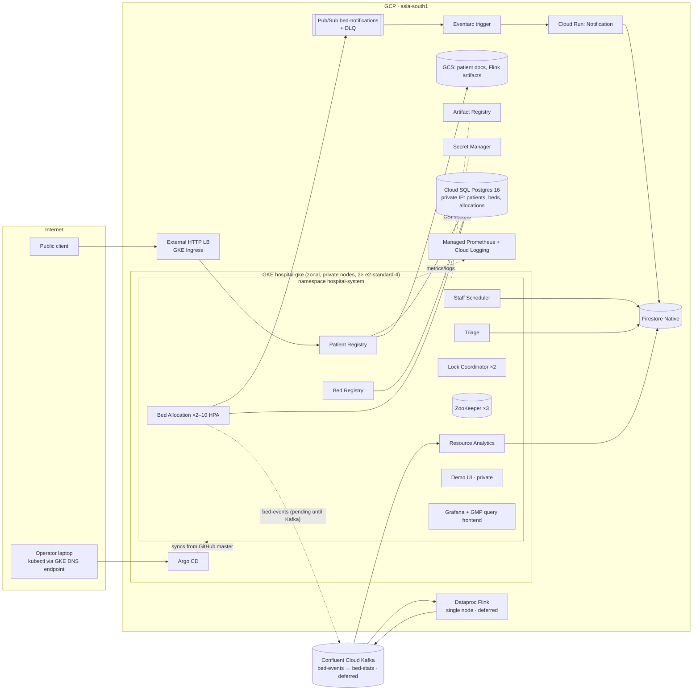
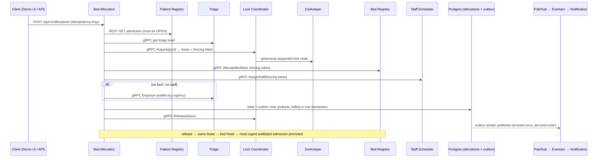

# As-built supplement to the design document

The design document is `cloud_proj_plan.docx` (Nisarg, 22 Oct 2026). It covers every section the brief asks for. This supplement records what was actually built and
deployed, and where that differs from the plan, so the submission does not describe things that do not exist.
Diagrams are Mermaid; render them on GitHub or paste into mermaid.live to export PNGs for the report.

## 1. Cloud deployment architecture (GCP project hospital-management-514618, asia-south1)

## 2. Microservice interactions (one allocation)

## 3. Responsibilities and links (as deployed)

| Service | Owner | Exposes | Calls | Storage |
|---|---|---|---|---|
| Patient Registry | Ruchir | REST :8000 (public `GET /healthz` only) | — | Cloud SQL `patients`, GCS |
| Staff Scheduler | Ruchir | REST :8000, gRPC :50051 | — | Firestore |
| Lock Coordinator | Nisarg | gRPC :50051, REST :8000 | ZooKeeper :2181 | ZooKeeper PVCs |
| Notification | Nisarg | Cloud Run `POST /` (Eventarc push) | — | Firestore (dedup, gaps) |
| Bed Registry | Jay | REST :8000, gRPC :50053 | — | Cloud SQL `beds` |
| Resource Analytics | Jay | REST :8008 | Kafka `bed-stats` (deferred) | Firestore `pool_stats` |
| Bed Allocation | Pratham | REST :8000 | PR (REST); Triage, Lock, Bed, Staff (gRPC); Pub/Sub; Kafka (deferred) | Cloud SQL `allocations` |
| Triage | Pratham | REST :8000, gRPC :50051 | — | Firestore (`waitlist_admission_index`) |
| Flink job | Jay | — | Kafka `bed-events` → `bed-stats` | GCS checkpoints |

Communication mechanisms used: REST (clients, Patient Registry), gRPC (all internal calls on the allocation path),
message queues (Pub/Sub now; Kafka for analytics).

## 4. Differences from the plan (record these in the report)

1. **Delivery phases.** Confluent Cloud Kafka and the Flink job are provisioned in a second phase. Until then
   Allocation runs `OUTBOX_DESTINATIONS=pubsub`: Kafka events are written and kept pending, never dropped
   (`docs/kafka-enable/CHECKLIST.md`).
2. **Dataproc** is a single-node cluster (2 vCPU) to fit the 12-vCPU project quota next to two GKE nodes.
3. **Bed Registry** uses a migration identity (`bed_registry_migrator`) and a DML-only runtime role; it no longer
   creates tables at startup in GKE.
4. **Observability.** Prometheus is Google Managed Service for Prometheus (PodMonitoring, 60 s scrape).
   Grafana runs in-cluster (private) through the GMP query frontend. Logs go to Cloud Logging (GKE workload
   logging, Cloud Run, Dataproc).
5. **Access.** The control plane is reached through the IAM-gated GKE DNS endpoint. The public IP allowlist holds
   two shared WARP addresses and should be removed once everyone uses the DNS endpoint.
6. **Public URL.** Health-only today. The read-only availability endpoint and HTTPS are proposed in
   `docs/proposals/public-endpoint-https.md`.
7. **Demo UI.** A private console (`services/demo_ui`), not a ninth business service. It calls an allowlist of the
   real APIs.
8. **Requirement (b).** Notification is a Cloud Run service. A conversion to a Cloud Run function is pending
   Nisarg's review (`docs/proposals/serverless-function-handoff.md`).

## 5. Design rationale (short form; the full text is in the design document)

- **ZooKeeper leases with fencing tokens** (the S7 concept): replicas of Bed Allocation never double-book a bed.
  A stale lease holder is rejected by Bed Registry and Staff Scheduler through the monotonic token.
- **Transactional outbox:** a state change and its events commit atomically. Delivery is at-least-once with
  per-pool sequence numbers, so consumers deduplicate by `event_id` and detect gaps.
- **Managed stores per access pattern:** relational integrity on Cloud SQL; high-write triage, waitlist and
  analytics on Firestore; documents and checkpoints on GCS.
- **GitOps with digest-pinned images and a release gate in CI:** what runs is exactly what is in Git.
