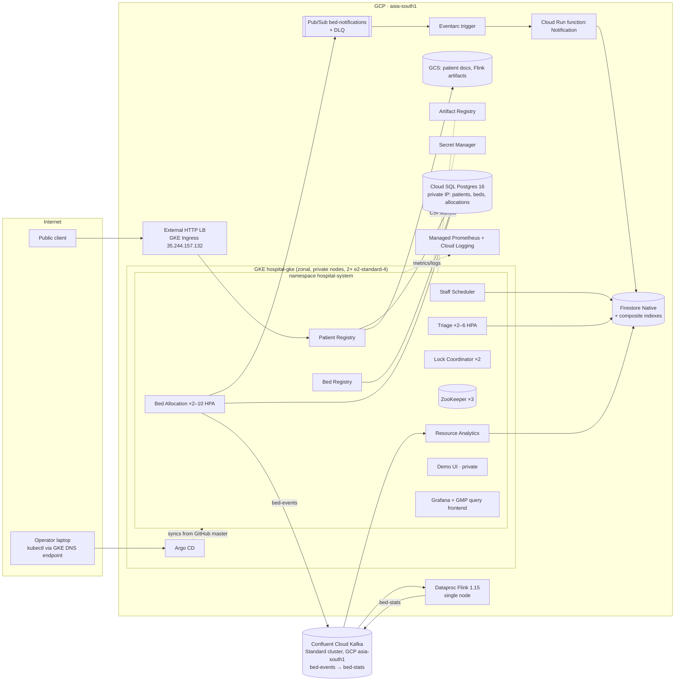
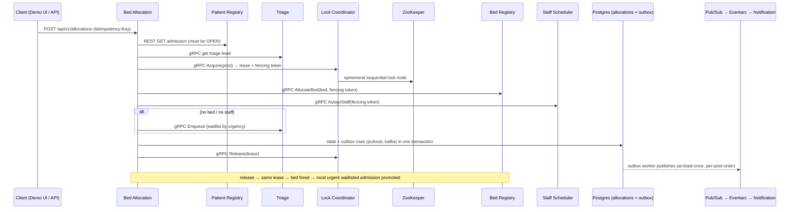

# As-built supplement to the design document

The design document is `cloud_proj_plan.docx` (Nisarg, 22 Oct 2026). It covers every section the brief asks for. This supplement records what was actually built and
deployed, and where that differs from the plan, so the submission does not describe things that do not exist.
Diagrams are Mermaid; render them on GitHub or paste into mermaid.live to export PNGs for the report.

## 1. Cloud deployment architecture (GCP project hospital-management-514618, asia-south1)

## 2. Microservice interactions (one allocation)

## 3. Responsibilities and links (as deployed)

| Service | Owner | Exposes | Calls | Storage |
|---|---|---|---|---|
| Patient Registry | Ruchir | REST :8000 (public: `/api/v1`, `/docs`, `/healthz`) | — | Cloud SQL `patients`, GCS |
| Staff Scheduler | Ruchir | REST :8000, gRPC :50051 | — | Firestore |
| Lock Coordinator | Nisarg | gRPC :50051, REST :8000 | ZooKeeper :2181 | ZooKeeper PVCs |
| Notification | Nisarg | Cloud Run function `hospital-notification-fn` (Eventarc on Pub/Sub `bed-notifications`) | — | Firestore (dedup, gaps) |
| Bed Registry | Jay | REST :8000, gRPC :50053 | — | Cloud SQL `beds` |
| Resource Analytics | Jay | REST :8008 | Kafka `bed-stats` | Firestore `pool_stats` |
| Bed Allocation | Pratham | REST :8000 | PR (REST); Triage, Lock, Bed, Staff (gRPC); Pub/Sub; Kafka `bed-events` | Cloud SQL `allocations` |
| Triage | Pratham | REST :8000, gRPC :50051 | — | Firestore (`waitlist_admission_index`) |
| Flink job | Jay | — | Kafka `bed-events` → `bed-stats` | GCS checkpoints |

Communication mechanisms used: REST (clients, Patient Registry), gRPC (all internal calls on the allocation path),
message queues (Pub/Sub for notifications; Kafka for analytics).

## 4. Differences from the plan (record these in the report)

1. **Delivery phases.** Confluent Cloud Kafka was provisioned in a second phase (a Standard cluster on GCP
   asia-south1, managed by Terraform). Until then Allocation ran `OUTBOX_DESTINATIONS=pubsub` and kept Kafka events
   pending; since PR #22 it publishes to both, and the backlog drained to zero. Events from before the switch arrive
   late for their original Flink windows (known limitation).
2. **Dataproc** is a single-node cluster (2 vCPU) to fit the 12-vCPU project quota next to two GKE nodes.
3. **Bed Registry** uses a migration identity (`bed_registry_migrator`) and a DML-only runtime role; it no longer
   creates tables at startup in GKE.
4. **Observability.** Prometheus is Google Managed Service for Prometheus (PodMonitoring, 60 s scrape).
   Grafana runs in-cluster (private) through the GMP query frontend. Logs go to Cloud Logging (GKE workload
   logging, the Cloud Run function, Dataproc).
5. **Access.** The control plane is reached through the IAM-gated GKE DNS endpoint. The public IP allowlist holds
   two shared WARP addresses and should be removed once everyone uses the DNS endpoint.
6. **Public URL.** Patient Registry is the public web service over plain HTTP: its REST API (`/api/v1`), the
   interactive `/docs` page and `/healthz`. `/metrics` and `/readyz` are not routed. Synthetic data only; HTTPS is
   optional (`docs/proposals/public-endpoint-https.md`).
7. **Demo UI.** A private console (`services/demo_ui`), not a ninth business service. It calls an allowlist of the
   real APIs.
8. **Requirement (b).** Notification is a Cloud Run function (2nd gen, `hospital-notification-fn`, PR #19), triggered
   through Eventarc by Pub/Sub `bed-notifications`, with `bed-notifications-dlq` after 10 attempts.
9. **Firestore indexes.** The waitlist query (Triage) and the analytics history query need composite indexes, managed
   in Terraform (`modules/firestore`). The plan did not list them; the emulator used in tests does not require them.
10. **Idempotency.** Every POST requires an `Idempotency-Key` header, including on the public API.
11. **Network access.** The Dataproc master is reached only through IAP SSH (firewall rule tagged `dataproc`); the
    project's `default` network was deleted.

## 5. Design rationale (short form; the full text is in the design document)

- **ZooKeeper leases with fencing tokens** (the S7 concept): replicas of Bed Allocation never double-book a bed.
  A stale lease holder is rejected by Bed Registry and Staff Scheduler through the monotonic token.
- **Transactional outbox:** a state change and its events commit atomically. Delivery is at-least-once with
  per-pool sequence numbers, so consumers deduplicate by `event_id` and detect gaps.
- **Managed stores per access pattern:** relational integrity on Cloud SQL; high-write triage, waitlist and
  analytics on Firestore; documents and checkpoints on GCS.
- **GitOps with digest-pinned images and a release gate in CI:** what runs is exactly what is in Git.
